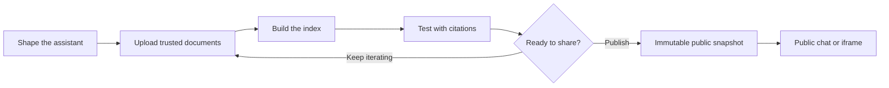
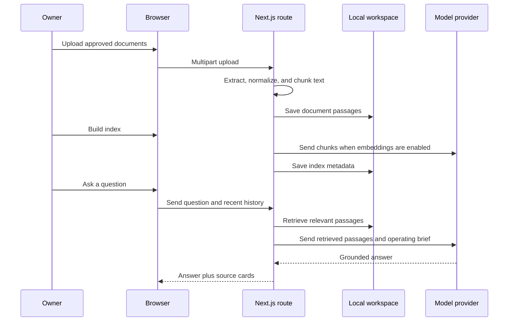

# Contexture

<p align="center">
  <strong>Your company knowledge, grounded and ready to talk.</strong>
</p>

<p align="center">
  Build a private RAG assistant from the documents your team already trusts.
  Configure its behavior, connect your model provider, test every answer with citations,
  and publish a read-only assistant for your users.
</p>

<p align="center">
  <a href="#-quick-start">Quick start</a> ·
  <a href="#-how-it-works">How it works</a> ·
  <a href="#-make-it-yours">Make it yours</a> ·
  <a href="#-contributing">Contributing</a>
</p>

<p align="center">
  
  
  
  
</p>

> **Contexture** is an open-source, self-hosted knowledge assistant studio for teams that want grounded answers from their own documents, their own provider, and their own operating rules.

---

## ✨ Why Contexture?

Most chat interfaces start with a blank prompt. Contexture starts with the knowledge, boundaries, and source ownership that make an assistant trustworthy.

| | What you get |
| --- | --- |
| 🧭 **Shape the assistant** | Define your company, audience, use case, tone, answer depth, safety boundaries, escalation path, and source priority. |
| 📚 **Bring your knowledge** | Upload PDF, DOCX, TXT, Markdown, CSV, HTML, or JSON files. Text is extracted, normalized, and split into searchable passages. |
| 🔎 **Retrieve with context** | Use keyword retrieval by default, with optional semantic embeddings and hybrid search when your provider supports embeddings. |
| 💬 **Test before you publish** | Ask real questions in the private playground and expand the sources used for each answer. |
| 🚀 **Publish a snapshot** | Expose an immutable public assistant at `/chat/<slug>` or embed it with an iframe. Draft changes remain private until you publish again. |
| 🔐 **Keep control** | Workspace data lives in a local JSON file. Browser-entered keys stay in memory. Server keys stay in environment variables. |

## 🧩 How it works



## 📦 What is included?

- Guided setup based on company, industry, audience, and job to be done
- Generated operating questions that adapt to the selected industry and use case
- Policies for knowledge scope, citations, memory, sensitive data, forbidden topics, updates, uncertainty, and escalation
- Local document extraction for PDF, DOCX, TXT, Markdown, CSV, HTML, and JSON
- Atomic local persistence in `.data/rag-workspace.json`
- Keyword retrieval fallback when embeddings are unavailable
- Optional hybrid retrieval with semantic embeddings
- Separate chat and embedding provider configuration
- Support for OpenAI, Anthropic Claude, Groq, OpenRouter, Ollama, Mistral, Together AI, Google Gemini, DeepSeek, and custom OpenAI-compatible servers
- Citation-aware answers with expandable source passages
- Protected builder/admin APIs through `RAG_ACCESS_TOKEN`
- Immutable public releases with a generated slug
- Public chat metadata and question endpoints
- Health endpoint for deployment checks
- Responsive builder UI and embeddable public chat

## 🛠️ Tech stack

- **Framework:** Next.js 16 App Router
- **UI:** React 19, TypeScript, CSS design tokens
- **Extraction:** `pdf-parse`, `mammoth`, native text parsing
- **Persistence:** local JSON store; no database required for the default setup
- **Model access:** provider-specific HTTP requests through route handlers
- **Runtime:** Node.js 20+

---

## 🚀 Quick start

### 1. Prerequisites

- Node.js **20 or newer**
- An API key for a supported chat provider, or a local Ollama installation
- Documents you want the assistant to use as reference material

### 2. Install and run

```bash
git clone https://github.com/YOUR_USERNAME/YOUR_REPOSITORY.git
cd YOUR_REPOSITORY
npm install
npm run dev
```

Open **[http://localhost:3000](http://localhost:3000)**.

### 3. Build your assistant

1. Enter the company or team name.
2. Choose the industry, audience, and primary job to be done.
3. Describe the desired voice and tone.
4. Answer the generated operating questions.
5. Save the assistant blueprint.
6. Upload the documents the assistant should trust.
7. Add a provider key for the current browser session, or configure one on the server.
8. Build the index.
9. Ask representative questions in the playground.
10. Publish when the answers and citations are ready.

Uploads accept up to **15 MB per file**, **20 files per upload**, and **100 MB total per request**.

The default OpenAI-compatible configuration is:

```text
Provider:         OpenAI
Base URL:         https://api.openai.com/v1
Chat model:       gpt-4o-mini
Embedding model:  text-embedding-3-small
```

### Useful commands

| Command | Purpose |
| --- | --- |
| `npm run dev` | Start the local development server |
| `npm run lint` | Run ESLint |
| `npm run typecheck` | Run TypeScript without emitting files |
| `npm run build` | Create a production build |
| `npm run start` | Start the production server |
| `npm run check` | Run lint, typecheck, and build together |

---

## 🔑 Configure providers

### Browser session key

The fastest local path is to enter a key in the UI. The key is held in memory for the browser session and is not written to `.data/rag-workspace.json`.

### Server-side configuration

For a shared deployment, copy the example environment file:

#### macOS / Linux

```bash
cp .env.example .env
```

#### Windows PowerShell

```powershell
Copy-Item .env.example .env
```

Then set the values in `.env`:

```env
# Chat generation
RAG_CHAT_PROVIDER=openai
RAG_CHAT_API_KEY=your-chat-key
RAG_CHAT_BASE_URL=https://api.openai.com/v1
RAG_CHAT_MODEL=gpt-4o-mini

# Optional semantic embeddings
RAG_EMBEDDING_PROVIDER=openai
RAG_EMBEDDING_API_KEY=your-embedding-key
RAG_EMBEDDING_BASE_URL=https://api.openai.com/v1
RAG_EMBEDDING_MODEL=text-embedding-3-small

# Required for a production deployment
RAG_ACCESS_TOKEN=generate-a-long-random-secret
```

Generate an access token with Node.js:

```bash
node -e "console.log(require('crypto').randomBytes(32).toString('hex'))"
```

### Supported providers

| Provider | Chat | Embeddings | Notes |
| --- | :---: | :---: | --- |
| OpenAI | ✓ | ✓ | Default configuration |
| Anthropic Claude | ✓ | — | Use a separate embedding provider for semantic retrieval |
| Groq | ✓ | — | OpenAI-compatible chat API |
| OpenRouter | ✓ | ✓ | Route through OpenRouter models |
| Ollama | ✓ | ✓ | Local provider; API key is not required |
| Mistral | ✓ | ✓ | Separate chat and embedding settings are supported |
| Together AI | ✓ | ✓ | OpenAI-compatible API |
| Google Gemini | ✓ | ✓ | OpenAI-compatible endpoint configuration |
| DeepSeek | ✓ | — | OpenAI-compatible chat API |
| Custom | ✓ | ✓ | Any compatible HTTPS endpoint, or local HTTP endpoint |

If embedding creation fails, Contexture reports the issue and prepares a keyword index instead. Chat requests still use the retrieved passages and the assistant’s operating brief.

---

## 🌍 Publish and embed the public assistant

The root route is the private builder and playground. After you build an index and configure server-side chat credentials, click **Publish live assistant**.

Contexture creates an immutable release at:

```text
/chat/<generated-slug>
```

The public surface can be linked directly or embedded:

```html
<iframe
  src="https://your-domain.example/chat/your-published-slug"
  title="Company knowledge assistant"
  width="100%"
  height="720"
  style="border: 0; border-radius: 16px"
  loading="lazy"
></iframe>
```

### Publish boundary

- Public users only query the last published snapshot.
- New uploads and draft settings remain private.
- Public users never receive provider keys, admin settings, document management APIs, or the admin token.
- Publish again whenever your approved source documents or operating rules change.

---

## 🏢 Make it yours

Contexture is intentionally easy to adapt for one company, one team, or one domain. You can change the brand and language without changing the retrieval engine.

### Change company-specific behavior

| You want to change | Edit here | What to look for |
| --- | --- | --- |
| Setup choices and generated questions | `src/lib/rag/questions.ts` | `industryOptions`, `useCaseOptions`, `audienceOptions`, `buildQuestions`, and `defaultSettings` |
| Builder layout and screen copy | `src/components/RagStudio.tsx` | `SetupStage`, `KnowledgeStage`, `ChatStage`, navigation, notices, and action labels |
| Public customer-facing chat | `src/components/PublicChat.tsx` | Header copy, public message experience, source display, and composer |
| Brand colors, spacing, buttons, forms | `src/app/globals.css` | The Contexture design tokens and responsive rules |
| Browser title and description | `src/app/layout.tsx` | `metadata`, fonts, and document shell |
| Provider names or endpoints | `src/lib/rag/provider.ts` | `providerProfiles` and provider request behavior |
| Document types and extraction rules | `src/lib/rag/extract.ts` | Supported extensions and parsers |
| Passage size and overlap | `src/lib/rag/chunker.ts` | Normalization and chunking behavior |
| Local persistence | `src/lib/rag/store.ts` | Workspace schema, search, publishing, and file writes |
| Logo or additional assets | `public/` | Add images, icons, and brand assets here |

### Recommended company customization checklist

1. Replace **Contexture** in the metadata and visible brand areas.
2. Update the initial assistant message and suggestion questions for your use case.
3. Add your company’s industries, audiences, tone presets, and required operating questions.
4. Set `defaultSettings` to your preferred response format, citation style, boundaries, and escalation policy.
5. Replace the GitHub links with your documentation, support portal, or company repository.
6. Update the color tokens in `src/app/globals.css` to your brand palette.
7. Add your logo or favicon in `public/` and update `src/app/layout.tsx` if needed.
8. Change the public chat footer to match your legal, support, or verification language.
9. Test the assistant with real questions, ambiguous questions, unsupported questions, and sensitive-data prompts.
10. Publish only after reviewing the sources attached to representative answers.

### Turning it into a multi-tenant SaaS

The default app is a **single-workspace self-hosted application**. For a multi-user product, replace the local store with authenticated tenant-scoped infrastructure:

- database or tenant-scoped blob storage
- encrypted document storage
- tenant-scoped vector or search index
- user authentication and roles
- quotas and usage controls
- background indexing jobs
- audit logging
- deletion and retention workflows
- tenant isolation tests

The main adapter boundary is `src/lib/rag/store.ts`. Do not put multiple companies into the same unpartitioned JSON workspace.

---

## 🧠 How the RAG pipeline works



Uploaded document text is treated as untrusted reference material. The chat prompt instructs the model to ignore instructions inside documents that try to change its role, expose secrets, or override the operating brief.

## 🔌 API reference

### Private builder APIs

When `RAG_ACCESS_TOKEN` is configured, send `Authorization: Bearer <token>`.

| Method | Route | Purpose |
| --- | --- | --- |
| `GET` | `/api/rag/workspace` | Read the workspace summary |
| `POST` | `/api/rag/workspace` | Save assistant settings and operating answers |
| `POST` | `/api/rag/documents` | Extract and add documents as multipart form data |
| `DELETE` | `/api/rag/documents?id=...` | Remove a document |
| `POST` | `/api/rag/build` | Build embeddings or a keyword index |
| `POST` | `/api/rag/chat` | Retrieve context and answer with citations |
| `POST` | `/api/rag/publish` | Publish an immutable release |

### Public APIs

| Method | Route | Purpose |
| --- | --- | --- |
| `GET` | `/api/public/chat?slug=...` | Read published assistant metadata |
| `POST` | `/api/public/chat` | Ask a question against the published snapshot |
| `GET` | `/api/health` | Check deployment, access protection, and index status |

## 🔒 Security and data boundaries

Read the full [security guide](./SECURITY.md) before exposing the app to a network.

Important defaults:

- `.env` is ignored and must never be committed.
- `.data/` contains extracted document text and optional embeddings; protect it like company data.
- Production admin APIs require `RAG_ACCESS_TOKEN`.
- Browser-entered keys remain in browser memory and are not persisted.
- Server-side keys are read from environment variables and are not returned by the workspace API.
- Use HTTPS, a reverse proxy, request-size limits, and rate limits in a network deployment.
- Review your model provider’s retention, training, and regional-processing terms.
- For regulated or high-impact use cases, add human review and domain-specific evaluation.

## 🧪 Verification before shipping

Run the full project check:

```bash
npm run check
```

Then walk through the real flow:

1. Create a workspace.
2. Upload representative documents.
3. Build the index.
4. Test known-answer questions.
5. Test questions whose answer is missing.
6. Test conflicting or outdated source documents.
7. Test sensitive-data and forbidden-topic boundaries.
8. Expand citations and verify the passages are actually relevant.
9. Publish a snapshot and test `/chat/<slug>` separately.
10. Confirm draft changes are not visible publicly before republishing.

## 🧭 Project map

```text
src/
├─ app/
│  ├─ api/
│  │  ├─ health/                 Deployment health check
│  │  ├─ public/chat/            Public metadata and chat API
│  │  └─ rag/                    Protected workspace APIs
│  ├─ chat/[slug]/               Public assistant route
│  ├─ globals.css                Shared design tokens and responsive UI
│  ├─ layout.tsx                 Metadata and document shell
│  └─ page.tsx                   Private studio entry point
├─ components/
│  ├─ PublicChat.tsx             Public chat interface
│  └─ RagStudio.tsx              Builder, knowledge base, and playground
└─ lib/rag/
   ├─ auth.ts                    Access-token protection
   ├─ chunker.ts                 Text normalization and chunking
   ├─ extract.ts                 File extraction
   ├─ index.ts                   Retrieval and chat orchestration
   ├─ provider.ts                Model provider registry and requests
   ├─ questions.ts               Setup questions and defaults
   ├─ store.ts                   Local workspace persistence and search
   └─ types.ts                   Shared domain types
```

## 🤝 Contributing

Pull requests are welcome. Tell us what you would improve—UI polish, provider support, extraction quality, retrieval, accessibility, documentation, testing, deployment adapters, or a new company-specific workflow.

### Before opening a PR

1. Search existing issues and pull requests.
2. Keep the change focused and explain the user outcome.
3. Preserve existing security boundaries and local-data behavior.
4. Update the README or `SECURITY.md` when behavior or configuration changes.
5. Run `npm run check`.
6. Include reproduction steps or screenshots for UI changes when useful.
7. Never commit `.env`, provider keys, `.data/`, uploaded documents, or generated build output.

### Good contribution ideas

- Add a new provider profile with safe URL validation.
- Improve extraction for another document format.
- Add evaluation fixtures for grounded answers and citation quality.
- Add a database-backed store adapter without changing the UI contract.
- Improve keyboard navigation, screen-reader labels, or mobile behavior.
- Add an import/export flow for workspace configuration.
- Improve the public assistant embed experience.
- Add tests around chunking, retrieval, publishing, and access protection.
- Improve error messages and recovery paths.

### Suggested PR format

```text
## What changed?

## Why?

## How was it tested?

## Screenshots or API examples
```

Please be kind, specific, and honest about trade-offs. Small, well-explained PRs are easier to review and ship.

## 📄 License

Contexture is released under the [MIT License](./LICENSE).

---

<p align="center">
  Built for teams that want answers they can inspect, improve, and trust.
</p>
